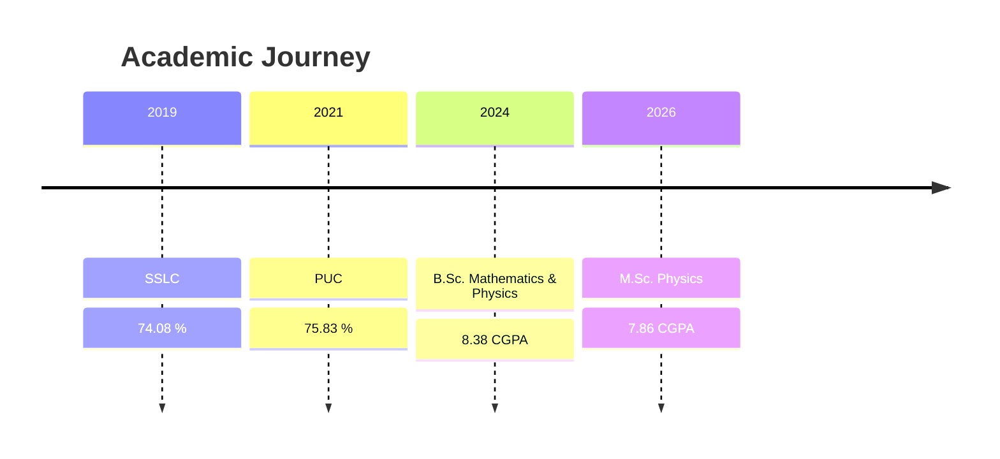

<!--
  ╔══════════════════════════════════════════════════════════════╗
  ║  SETUP: Find & Replace  YOUR_GITHUB_USERNAME  with your      ║
  ║  real GitHub username (the repo must be named the same).     ║
  ╚══════════════════════════════════════════════════════════════╝
-->

<!-- ═══════════════ ANIMATED HEADER BANNER ═══════════════ -->
<div align="center">


<!-- Animated typing intro -->
<a href="https://git.io/typing-svg">
  
</a>

<br/>


<br/><br/>

<a href="mailto:chandanac661@gmail.com"></a>
<a href="https://www.linkedin.com/in/YOUR_LINKEDIN_USERNAME"></a>
<a href="https://github.com/YOUR_GITHUB_USERNAME"></a>

</div>

---

## 👩‍💻 About Me

```text
┌──────────────────────────────────────────────────────────────┐
│  👤  Name        :  Chandana C                               │
│  🎓  Education   :  M.Sc. Physics (2026) · University of Mysore│
│  🔬  Interests   :  Physics · Mathematics · Teaching · Tech  │
│  🌐  Languages   :  Kannada · English · Hindi (conversational)│
│  📍  Based in    :  Mysuru, Karnataka, India 🇮🇳              │
│  📫  Reach me    :  chandanac661@gmail.com                   │
└──────────────────────────────────────────────────────────────┘
```

> *"Motivated and hardworking individual seeking an opportunity to utilize my skills, knowledge and dedication to contribute to the success of the organization while continuously learning and growing professionally."*

I hold a Master's degree in Physics and bring a strong analytical foundation in **mathematics and scientific reasoning**, combined with **communication, leadership and teamwork** skills. I'm now channeling that foundation into learning technology and building projects, which I share on this profile.

---

## 🎓 Education

<div align="center">

| 🎯 Qualification | 🏫 Institution | 🏛️ Board / University | 📅 Year | 📊 Score |
|:---|:---|:---|:---:|:---:|
| **M.Sc. in Physics** | Maharani Science College for Women, Mysuru | University of Mysore | **2026** | **7.86 CGPA** |
| **B.Sc. (Mathematics, Physics)** | Maharani Science College for Women, Mysuru | University of Mysore | **2024** | **8.38 CGPA** |
| **PUC** | Vivekananda PU College, Mysuru | Karnataka Pre-University Board | **2021** | **75.83 %** |
| **SSLC** | Mahadeshwara Vidya Samsthe, Mysuru | Karnataka State Board | **2019** | **74.08 %** |

</div>

### 📈 Academic Progress



---

## 🛠️ Skills & Strengths

<div align="center">


<br/>


</div>

### 🧭 Skill Overview

| Domain | Skills |
|:---|:---|
| 🧠 **Core / Analytical** | Physics · Mathematics · Problem-Solving · Logical Reasoning |
| 🗣️ **Communication** | Clear Communication · Student Motivation & Support · Mentoring |
| 📚 **Teaching & Planning** | Classroom Management · Lesson Planning · Curriculum Development |
| 🤝 **Interpersonal** | Teamwork · Leadership · Patience · Adaptability |
| ⏱️ **Productivity** | Time Management |

<!--
  ┌───────────────────────────────────────────────────────────┐
  │ OPTIONAL: Add your TECH STACK here once you've learned it │
  │ (only list what you genuinely know). Example badges:      │
  │                                                           │
  │ 
  │ 
  │ 
  │ 
  └───────────────────────────────────────────────────────────┘
-->

---

## 🌱 Currently

- 🔭 Completed **M.Sc. in Physics** at University of Mysore (2026)
- 📖 Learning and exploring technology alongside my science background
- 🎯 Looking for opportunities in **teaching, academia, research support & entry-level roles**
- 💬 Ask me about **Physics, Mathematics, study techniques & helping others learn**

---

## 🏆 GitHub Trophies

<div align="center">

<a href="https://github.com/ryo-ma/github-profile-trophy">
  
</a>

</div>

---

## 📊 GitHub Stats Dashboard

<div align="center">

<!-- Row 1: Stats + Top Languages -->


<br/>

<!-- Row 2: Streak -->


<br/>

<!-- Row 3: Activity graph (animated line chart) -->


<br/>

<!-- Row 4: Contribution snake (animated) — needs the workflow shown below -->


</div>

<details>
<summary>🐍 <b>Enable the animated contribution snake (click to expand)</b></summary>

<br/>

Create the file `.github/workflows/snake.yml` in your profile repo:

```yaml
name: Generate Snake Animation

on:
  schedule:
    - cron: "0 0 * * *"      # runs daily
  workflow_dispatch:
  push:
    branches: [main]

permissions:
  contents: write

jobs:
  generate:
    runs-on: ubuntu-latest
    steps:
      - uses: Platane/snk@v3
        with:
          github_user_name: ${{ github.repository_owner }}
          outputs: |
            dist/github-contribution-grid-snake-dark.svg?palette=github-dark
            dist/github-contribution-grid-snake.svg
      - uses: crazy-max/ghaction-github-pages@v3.1.0
        with:
          target_branch: output
          build_dir: dist
        env:
          GITHUB_TOKEN: ${{ secrets.GITHUB_TOKEN }}
```

Then go to **Actions → Generate Snake Animation → Run workflow**.

</details>

---

## 📌 Featured Projects

<!-- Replace with your own repos. Pin cards update automatically. -->

<div align="center">

<a href="https://github.com/YOUR_GITHUB_USERNAME/YOUR_REPO_NAME">
  
</a>
<a href="https://github.com/YOUR_GITHUB_USERNAME/YOUR_REPO_NAME_2">
  
</a>

</div>

> 💡 *Projects coming soon. Watch this space!*

---

## 🎯 Interests & Hobbies

<div align="center">

| 📖 Reading | ✍️ Writing | 🎧 Music | 🤝 Helping Others Learn |
|:---:|:---:|:---:|:---:|
| Books & science | Notes & articles | Listening & relaxing | Teaching & mentoring |

</div>

---

## 🧰 Goals Roadmap


---

## 📬 Let's Connect

<div align="center">

<a href="mailto:chandanac661@gmail.com"></a>
<a href="https://www.linkedin.com/in/YOUR_LINKEDIN_USERNAME"></a>
<a href="tel:+916362019926"></a>

<br/><br/>

⭐ *If you like my profile, feel free to follow and star my repositories!* ⭐


</div>


